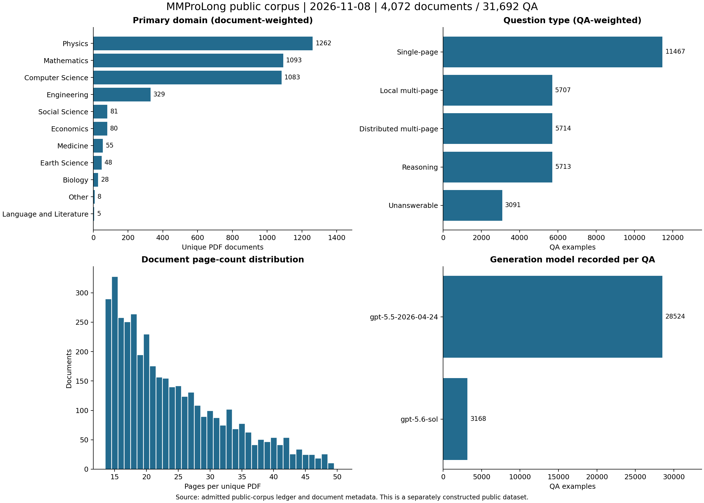
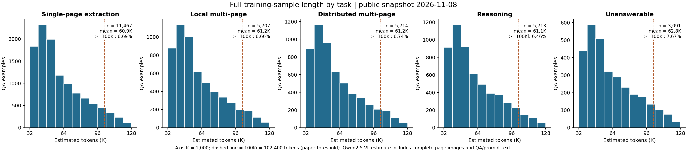
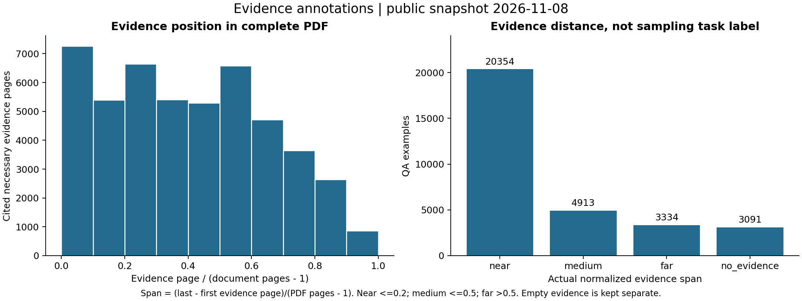

# MMProLong public dataset: provenance, labels, and statistics

[Hugging Face dataset](https://huggingface.co/datasets/ZhaoweiWang/MMProLong-public-5B) | [Full dataset card](https://huggingface.co/datasets/ZhaoweiWang/MMProLong-public-5B/blob/main/README.md) | [MMProLong paper](https://arxiv.org/abs/2605.13831) | [Project README](../README.md)

**This is a separately constructed public corpus, not the original training data used in the MMProLong paper. Due to ByteDance's internal data governance and management requirements, the original paper corpus cannot be open-sourced.** The public corpus is constructed from public arXiv documents and does not establish reproduction of the paper's reported results.

The current production pipeline uses **GPT-5.6-sol**. The snapshot also contains historical **GPT-5.5** examples; the exact breakdown and per-document sampling history are reported below. Cite the [MMProLong paper](../README.md#citation) when using this public release.

## Scope and conventions

These measurements cover the **2026-11-08 admitted snapshot**: 31,692 QA, 4,072 unique documents, and 1,940,838,080 estimated training tokens. The target is exactly 5,000,000,000 tokens; it has not yet been reached. Rejected and unfinished candidates are excluded.

The manuscript's source pool contains 1,537,504 PDFs across several document families; its default VQA study reports 177,774 examples and 15.16B tokens across three task-specific pools. The public release has a different population: arXiv research papers, observed page range 14-50, five QA types, and a GPT-based full-document generation/review pipeline. The original paper uses Seed 2.0 and coherent 8-15-page segments for its VQA synthesis. Those are different artifacts and experiments.

The manuscript defines binary prefixes (K=1024, B=2^30). Public tables below use decimal K=1,000 and B=1,000,000,000; the >=100Ki statistic uses 102,400 to match the paper threshold. Exact raw counts are preserved in [statistics.json](https://huggingface.co/datasets/ZhaoweiWang/MMProLong-public-5B/blob/main/metadata/statistics.json).

### Corpus scale

| Statistic | Public snapshot value |
| --- | --- |
| Admitted unique PDFs | 4,072 |
| Document family | arXiv research papers |
| Unique rendered page images | 98,412 |
| Document pages: mean / median | 24.17 / 22 |
| Document pages: range / 5th-95th percentile | 14-50 / 14-42 |
| Admitted QA examples | 31,692 |
| Estimated training tokens | 1,940,838,080 (1.941B) |
| Per-QA tokens: mean / median | 61.241K / 54.789K |
| Observed token range | 33,547-125,503 |
| At least 100,000 tokens | 2,550 (8.05%) |
| At least 100Ki = 102,400 tokens (paper threshold) | 2,138 (6.75%) |
| Page references across all QA contexts | 763,851 |
| 5,000,000,000-token production target reached | 38.82% |

Tokens are the stored Qwen2.5-VL serialized-sample estimate, including full page-image context and QA/prompt text. A PDF used by several questions contributes its context repeatedly to the training-token total. This is not a count of unique-text tokens or billed API tokens. Page images are physically stored once per document.

### Task-level statistics

| Task | QA | Avg. pages | Avg. K tokens | B tokens | Pages | K-token range | >=100Ki |
| --- | --- | --- | --- | --- | --- | --- | --- |
| `single` | 11,467 | 23.99 | 60.94 | 0.699 | 14-50 | 33.80-125.13 | 6.69% |
| `multi_local` | 5,707 | 24.07 | 61.23 | 0.349 | 14-50 | 33.85-125.50 | 6.66% |
| `multi_distributed` | 5,714 | 24.06 | 61.16 | 0.349 | 14-50 | 33.84-125.29 | 6.74% |
| `reasoning` | 5,713 | 24.06 | 61.09 | 0.349 | 14-50 | 33.55-125.11 | 6.46% |
| `unanswerable` | 3,091 | 24.73 | 62.80 | 0.194 | 14-50 | 33.79-125.09 | 7.67% |
| **Total** | 31,692 | 24.10 | 61.24 | 1.941 | 14-50 | 33.55-125.50 | 6.75% |

`K = 1,000`, `B = 1,000,000,000`; `100Ki = 102,400` tokens. Average pages in this table are **QA-weighted**, whereas the corpus-scale document average counts each PDF once. The two multi-page rows may be combined for comparison with the paper's broader extraction category. Unanswerable QA is an additional public-data task. Exact values, quantiles, and the combined task grouping are in [`metadata/statistics.json`](https://huggingface.co/datasets/ZhaoweiWang/MMProLong-public-5B/blob/main/metadata/statistics.json).

### Primary-domain distribution

| Primary domain | Documents | Document share | QA | QA share |
| --- | --- | --- | --- | --- |
| Physics | 1,262 | 30.99% | 9,167 | 28.93% |
| Mathematics | 1,093 | 26.84% | 8,545 | 26.96% |
| Computer Science | 1,083 | 26.60% | 8,849 | 27.92% |
| Engineering | 329 | 8.08% | 2,599 | 8.20% |
| Social Science | 81 | 1.99% | 645 | 2.04% |
| Economics | 80 | 1.96% | 643 | 2.03% |
| Medicine | 55 | 1.35% | 492 | 1.55% |
| Earth Science | 48 | 1.18% | 421 | 1.33% |
| Biology | 28 | 0.69% | 245 | 0.77% |
| Other | 8 | 0.20% | 56 | 0.18% |
| Language and Literature | 5 | 0.12% | 30 | 0.09% |

Document and QA shares differ because historical phases generated different numbers of questions per PDF. Domain labels describe the source PDF, not a separate topic inferred for each question.

### Answer types and per-document sampling

| Answer format | QA | Share |
| --- | --- | --- |
| List | 10,614 | 33.49% |
| String | 11,737 | 37.03% |
| Integer | 4,766 | 15.04% |
| Float | 1,484 | 4.68% |
| Unanswerable | 3,091 | 9.75% |

There are **28,601 answerable** and **3,091 unanswerable** QA examples. The observed necessary-evidence page counts are: 0 pages: 3,091, 1 pages: 14,450, 2 pages: 9,399, 3 pages: 3,807, 4 pages: 945.

Observed QA count per source document

| QA per document | Documents |
| --- | --- |
| 1 | 162 |
| 2 | 1,503 |
| 6 | 1 |
| 8 | 1 |
| 9 | 7 |
| 10 | 51 |
| 11 | 259 |
| 12 | 2,084 |
| 20 | 4 |

The 20-QA documents belong to the initial pilot; the two-QA limit applies to the current GPT-5.6 phase.

## Document language

| Estimated document language | Documents | Document share | Associated QA |
| --- | --- | --- | --- |
| English (`en`) | 4,068 | 99.902% | 31,654 |
| Spanish (`es`) | 2 | 0.049% | 14 |
| Russian (`ru`) | 1 | 0.025% | 12 |
| Chinese (`zh`) | 1 | 0.025% | 12 |

These are automatic dominant-language estimates from embedded text on up to six body pages per PDF, using langid 1.1.6. Non-English/uncertain initial predictions are rechecked after normalizing text and removing short equation-like lines. No OCR is used. Scores are not calibrated accuracy probabilities, and these are not human-verified labels. [Per-document detection records](https://huggingface.co/datasets/ZhaoweiWang/MMProLong-public-5B/blob/main/metadata/document_languages.jsonl) preserve method, sampled pages, score, and recheck provenance.

## Labels and provenance

All 4,072 documents have one primary-domain label across 11 categories. Recorded methods are full-context generator majority votes (3,962 documents), arXiv primary-category mapping (101), and pilot topic assignments (9). These are source-document labels; the QA taxonomy is separate.

Use the [document metadata viewer](https://huggingface.co/datasets/ZhaoweiWang/MMProLong-public-5B/viewer/documents/train) or [document_labels.parquet](https://huggingface.co/datasets/ZhaoweiWang/MMProLong-public-5B/resolve/main/metadata/document_labels.parquet) for one row per PDF. The [QA viewer](https://huggingface.co/datasets/ZhaoweiWang/MMProLong-public-5B/viewer/default/train) also exposes domain, model, generation phase, document language/page counts, and derived evidence fields. Join them by `document_id`.

Evidence uses zero-based original PDF pages. Normalized span is `(last-first)/(page_count-1)`; near <=0.2, medium <=0.5, and far >0.5. Empty evidence is `no_evidence`, not near. Local/distributed task labels encode the sampling rule and are distinct from the measured span.

## Generation models and sampling history

| Recorded generation model | Documents | QA | QA share | B training tokens |
| --- | --- | --- | --- | --- |
| `gpt-5.5-2026-04-24` | 2,407 | 28,524 | 90.00% | 1.745 |
| `gpt-5.6-sol` | 1,665 | 3,168 | 10.00% | 0.196 |

| Phase | Documents | QA | Maximum QA per document |
| --- | --- | --- | --- |
| Initial pilot (GPT-5.5) | 4 | 80 | 20 |
| GPT-5.5 production | 2,403 | 28,444 | 12 |
| Current GPT-5.6 production | 1,665 | 3,168 | 2 |

The current snapshot is a **mixed-model historical release**, not an all-GPT-5.6 corpus. Use the `model` field when a model-specific subset is required.

The current GPT-5.6 configuration uses full-document generation and verification, 128 workers, one QA per request, at most two QA per document, and a document-level semantic-redundancy check. Target token shares are 36% single, 18% local multi, 18% distributed multi, 18% reasoning, and 10% unanswerable. Model reviews and topic/language labels remain fallible; benchmark decontamination, comprehensive human review, and GPU ingestion validation are incomplete for this new public corpus.

## Download and reproduce

Follow the [dataset card's download instructions](https://huggingface.co/datasets/ZhaoweiWang/MMProLong-public-5B#download-and-use). Images are shared once per PDF and restored from checksummed archives. The reference-only training Parquet uses relative image paths; load image bytes on demand rather than duplicating all pages for every question.

The [public synthesis snapshot](https://huggingface.co/datasets/ZhaoweiWang/MMProLong-public-5B/tree/main/code) is hosted with the data. This repository provides the reproducible [statistics generator](../scripts/profile_public_dataset.py), [initial language annotator](../scripts/annotate_public_document_languages.py), and [language recheck](../scripts/recheck_public_document_languages.py). The statistics script only needs the small QA/metadata files and optional published language labels; it does not need the restored PDF/image corpus. Language recomputation streams verified source archives in memory and fetches selected PDF byte ranges for rechecks.

Source documents retain their article-level licenses and exceptions. The code license does not assign a blanket license to source PDFs or synthetic QA. See the [dataset card's rights and quality notes](https://huggingface.co/datasets/ZhaoweiWang/MMProLong-public-5B#quality-checks-and-limitations).
